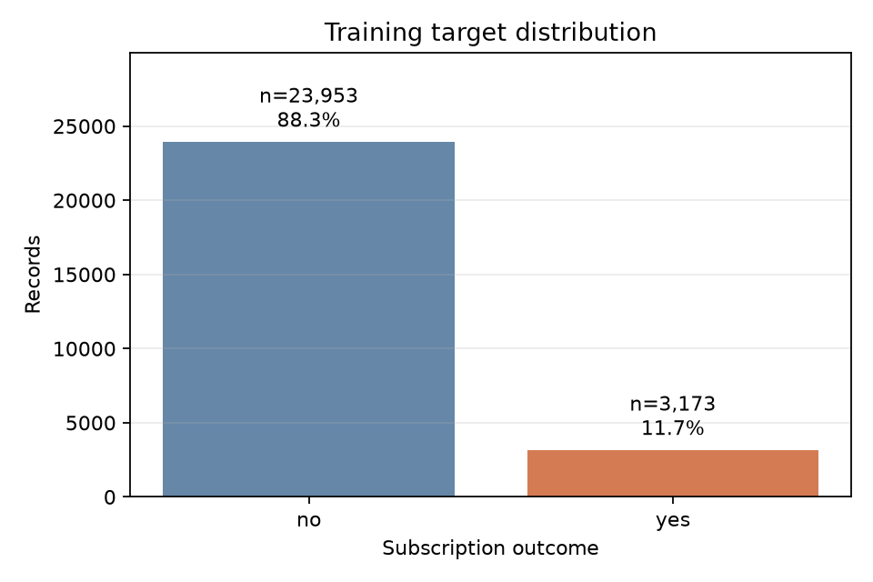
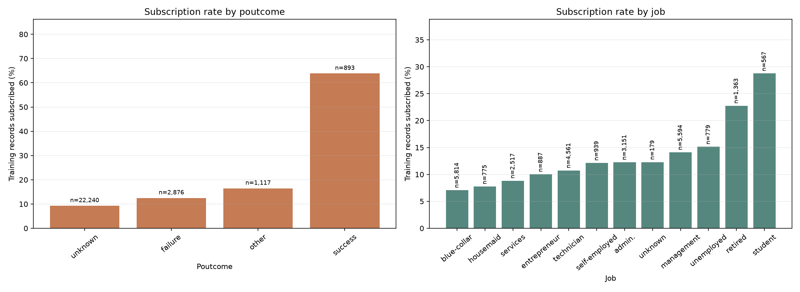

# CA6001 Applied AI Algorithms Project

## A/B/C Technical Draft — Development Evidence Only

Working draft for group integration; student names remain blank. It reports development and validation only. D thresholds and final test results remain for D.

## 1. Introduction

We rank historical records by term-deposit subscription in a retrospective pre-campaign screening simulation, comparing four classifiers with a prior Dummy baseline. The task estimates neither causal marketing impact nor verified historical field availability.

## 2. Problem Definition

For record i, yᵢ ∈ {0,1} (yes=1); the model produces a subscription score sᵢ ∈ [0,1] via predict_proba, with development predictions at sᵢ≥0.5. Scores are not guaranteed to be calibrated population probabilities. AP assesses ranking for the minority class (scikit-learn developers, n.d.-a). The unit is a record, not a verified customer; no customer ID or complete as-of snapshot supports customer-level or future-period claims.

## 3. Dataset Description

UCI legacy bank-full.csv has 45,211 records, 16 inputs, and a target (17 columns; Moro et al., 2011, 2014). Train/validation/test sizes are 27,126/9,042/9,043; train yes rate is 11.697%. Eleven retained fields: age, job, marital, education, default, balance, housing, loan, pdays, previous, poutcome. Duration, campaign, contact, day, and month are excluded.

pdays becomes `has_previous_contact = (pdays >= 0)`; exact days are dropped. Unknowns, negative/extreme balances, and all rows remain. Train has 2,280 negative balances. Duplicate excess rows (rows minus unique profiles) are 575 for the 11 source fields with exact pdays, and 582 after replacing pdays with the contact flag. Neither count identifies customers; no rows are removed. There are 5 rows with previous>0 but unknown poutcome. Figure 1 shows train target distribution.



*Figure 1. Training-partition target distribution (yes = 1).*

## 4. Algorithm Selection and Rationale

Logistic Regression models log-odds as β₀+βᵀx: regularized and economical, but linear without added features. A Gini-split Decision Tree captures nonlinear rules and interactions and is inspectable, but can be unstable or overfit (scikit-learn developers, n.d.-c, n.d.-e).

Random Forest averages bootstrap, feature-sampled trees to reduce variance but limits direct interpretability. MLP affine/ReLU layers model nonlinear combinations but require scaled numeric inputs and regularization. Dummy prior is the baseline; boosting and time/customer-grouped evaluation remain unrun alternatives (scikit-learn developers, n.d.-d, n.d.-f, n.d.-g).

## 5. Methodology

The fixed stratified 60/20/20 split uses seed 42. Only train (27,126) enters shuffled 3-fold StratifiedKFold CV. Prespecified searches maximize mean AP; lower config_id breaks ties. AP is non-interpolated average_precision_score, not trapezoidal PR-AUC (scikit-learn developers, n.d.-a). Winners are refit on train and scored on validation for diagnosis and D’s threshold choice, not further tuning. No test predictions or test-performance analysis are reported.

A shared pipeline derives the prior-contact flag and one-hot encodes categories. The literal value "unknown" is retained as a category. Categories not seen during the current fit are encoded as an all-zero block at transform time; records remain. Scale numeric inputs only for Logistic Regression and MLP. Balanced weights are computed per fit fold; scoring is unweighted. No SMOTE, global scaling, clipping, or deduplication; development threshold is 0.5 (scikit-learn developers, n.d.-b).

Searches contain 8 LR, 12 DT, 8 RF and 8 MLP configurations (36 total; 108 base CV fits). LR C={0.01,0.1,1,10}; DT depth={4,8,None} and leaf={100,20}; RF depth={10,None} and leaf={20,5}; MLP layers={(32,),(64,32)} and alpha={0.01,0.0001}. Each crosses unweighted/balanced fits. RF uses 200 trees, sqrt feature subsampling and bootstrap. MLP uses Adam/ReLU, learning rate=0.001, batch=256, early_stopping=False, tol=0.0001 and n_iter_no_change=20. Every MLP fit that reaches 300 iterations with a ConvergenceWarning restarts once from scratch with the same seed and a 600-iteration cap; final warnings remain in the record. Mean ± SD uses three folds and sample SD (ddof=1), not a confidence interval. Full configurations are in search_configs.json.

Run versions: Python 3.12.10, scikit-learn 1.8.0, NumPy 2.4.6, pandas 3.0.3, Matplotlib 3.11.2, joblib 1.6.0 (Python Software Foundation, n.d.; NumPy developers, n.d.; pandas development team, n.d.; Matplotlib developers, n.d.; Joblib developers, n.d.). Codex/ChatGPT Pro assisted drafting and software development (OpenAI, n.d.); reported metrics come from local run artifacts.

## 6. Implementation

The data module validates source and splits; preprocessing stays in the pipeline. Training logs fold candidates, refits winners on train, reloads pipelines, and checks validation probabilities. Core functions: read_raw, load_partition, audit_data, build_preprocessor, score_fold, train_family, run_experiment.

```python
for fit_ids, score_ids in folds:
    fitted, history = fit_candidate(name, config, X.iloc[fit_ids], y.iloc[fit_ids])
    p_yes = fitted.predict_proba(X.iloc[score_ids])[:, 1]
    fold_ap = average_precision_score(y.iloc[score_ids], p_yes)
```

Across 24 MLP CV folds, 21 required one retry and 6 final attempts warned. See Section 8 for selected-fold details.

## 7. Results and Evaluation — Development Only

The completed run recommends Random Forest by CV AP for development. Table 1 shows selected configurations and CV AP mean ± SD; Table 2 gives validation metrics at 0.5. These are development results, not a final test conclusion.

**Table 1. Selected train-CV configurations.**

| Model | Selected train-CV configuration | CV AP (mean ± SD) |
| --- | --- | --- |
| Dummy prior | weight=unweighted | 0.117 ± 0.000 |
| Logistic Regression | C=0.1; weight=unweighted | 0.342 ± 0.009 |
| Decision Tree | max_depth=None; min_samples_leaf=100; weight=unweighted | 0.336 ± 0.008 |
| Random Forest | max_depth=None; min_samples_leaf=20; weight=balanced | 0.359 ± 0.009 |
| MLP | alpha=0.01; hidden_layer_sizes=(32,); weight=unweighted | 0.333 ± 0.015 |

**Table 2. Validation metrics at threshold 0.5.**

| Model | AP | ROC-AUC | Accuracy | F1 | Precision | Recall |
| --- | --- | --- | --- | --- | --- | --- |
| Dummy prior | 0.117 | 0.500 | 0.883 | 0.000 | 0.000 | 0.000 |
| Logistic Regression | 0.359 | 0.721 | 0.894 | 0.272 | 0.704 | 0.168 |
| Decision Tree | 0.370 | 0.725 | 0.895 | 0.279 | 0.702 | 0.174 |
| Random Forest | 0.387 | 0.744 | 0.789 | 0.383 | 0.291 | 0.560 |
| MLP | 0.377 | 0.738 | 0.894 | 0.278 | 0.689 | 0.174 |

Across all 4 matched RF parameter pairs, balanced weighting changed mean CV AP by -0.0006 to +0.0011; 2/4 pairs increased. These small, mixed changes do not establish a general ranking benefit from weighting. At 0.5, paired CV accuracy changes ranged from -0.1173 to -0.0633. Ranking, threshold performance and probability accuracy are separate objectives; selection used CV AP. Weighted predict_proba scores are not assumed to be calibrated population probabilities.



*Figure 2. Training-only subscription rates by prior campaign outcome and job; labels show group n.*

## 8. Discussion & Insights

Of 24 MLP CV folds, 21 first attempts required the fixed one-retry rule; 6 final attempts still warned. Selected MLP alpha=0.01; hidden_layer_sizes=(32,); weight=unweighted training/CV AP was 0.420 / 0.333 (gap 0.088). After retries, its final warning flags were 0/3 (1 selected fold(s) retried). The train refit finished at 185 iterations with warning=false (1 attempt). Averaged over the four tested configurations per architecture, (64, 32) had a train-minus-CV AP gap of 0.404 versus 0.099 for (32), consistent with overfitting in this search. Some larger-network fits still warned; architecture and optimization effects are not isolated. Absence of a warning means the configured stopping rule was met, not that a global optimum was found.

Historical row-split results describe record-level generalization only: no customer ID supports customer-disjoint evaluation, and the prediction-time snapshot is incomplete. They do not establish future-campaign performance or causal effects. AP measures ranking; Table 2 precision, recall, F1, and accuracy use 0.5. Figure 2 is descriptive, and data vintage or population bias may shape subgroup patterns.

## 9. Conclusion — D to Complete

D will complete the final conclusion after freezing thresholds and running the authorized one-shot test evaluation, integrating final metrics, error and importance analyses. No final winner or test result is asserted here.

## 10. References

Joblib developers. (n.d.). *joblib* (Version 1.6.0) [Computer software]. https://joblib.readthedocs.io/

Matplotlib developers. (n.d.). *Matplotlib* (Version 3.11.2) [Computer software]. https://matplotlib.org/

Moro, S., Laureano, R., & Cortez, P. (2011). Using data mining for bank direct marketing: An application of the CRISP-DM methodology. In P. Novais et al. (Eds.), *Proceedings of the European Simulation and Modelling Conference (ESM’2011)* (pp. 117–121). EUROSIS. https://hdl.handle.net/1822/14838

Moro, S., Rita, P., & Cortez, P. (2014). *Bank Marketing* [Data set]. UCI Machine Learning Repository. https://doi.org/10.24432/C5K306

NumPy developers. (n.d.). *NumPy* (Version 2.4.6) [Computer software]. https://numpy.org/

OpenAI. (n.d.). *ChatGPT Pro and Codex* [AI-assisted drafting and software-development tools]. https://openai.com/

pandas development team. (n.d.). *pandas* (Version 3.0.3) [Computer software]. https://pandas.pydata.org/

Python Software Foundation. (n.d.). *Python* (Version 3.12.10) [Computer software]. https://www.python.org/

scikit-learn developers. (n.d.-a). *Average precision score*. scikit-learn 1.8.0 API documentation. https://scikit-learn.org/1.8/modules/generated/sklearn.metrics.average_precision_score.html

scikit-learn developers. (n.d.-b). *Common pitfalls and recommended practices*. scikit-learn 1.8.0 user guide. https://scikit-learn.org/1.8/common_pitfalls.html

scikit-learn developers. (n.d.-c). *DecisionTreeClassifier*. scikit-learn 1.8.0 API documentation. https://scikit-learn.org/1.8/modules/generated/sklearn.tree.DecisionTreeClassifier.html

scikit-learn developers. (n.d.-d). *DummyClassifier*. scikit-learn 1.8.0 API documentation. https://scikit-learn.org/1.8/modules/generated/sklearn.dummy.DummyClassifier.html

scikit-learn developers. (n.d.-e). *LogisticRegression*. scikit-learn 1.8.0 API documentation. https://scikit-learn.org/1.8/modules/generated/sklearn.linear_model.LogisticRegression.html

scikit-learn developers. (n.d.-f). *MLPClassifier*. scikit-learn 1.8.0 API documentation. https://scikit-learn.org/1.8/modules/generated/sklearn.neural_network.MLPClassifier.html

scikit-learn developers. (n.d.-g). *RandomForestClassifier*. scikit-learn 1.8.0 API documentation. https://scikit-learn.org/1.8/modules/generated/sklearn.ensemble.RandomForestClassifier.html
