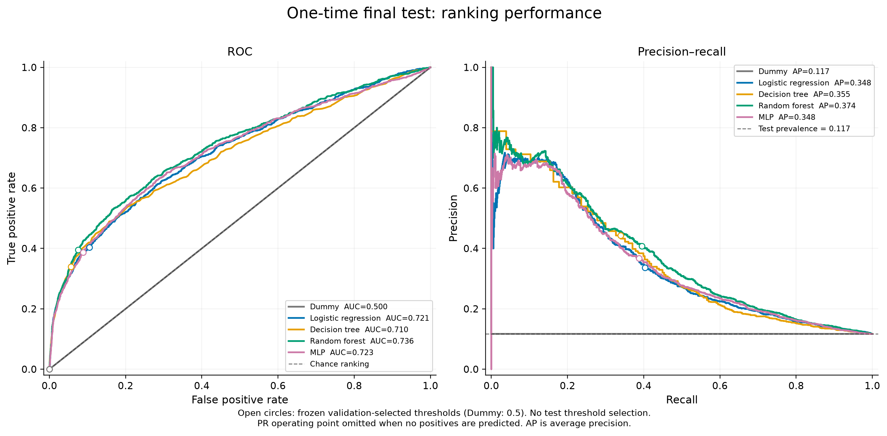
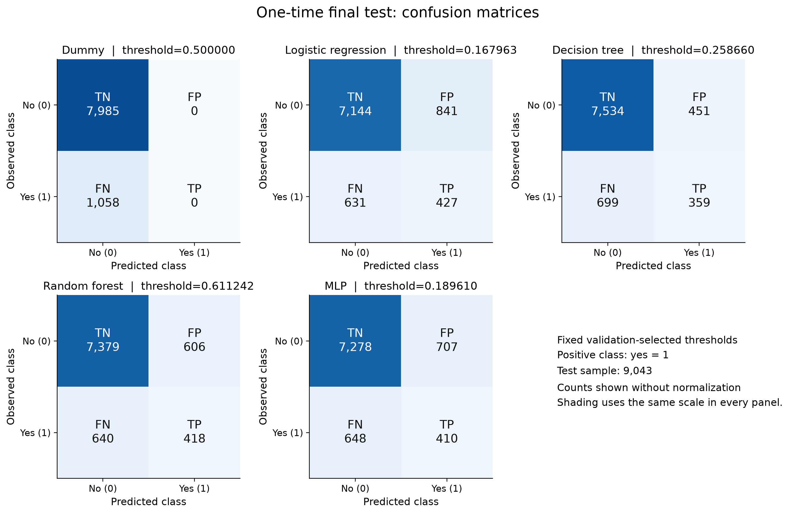
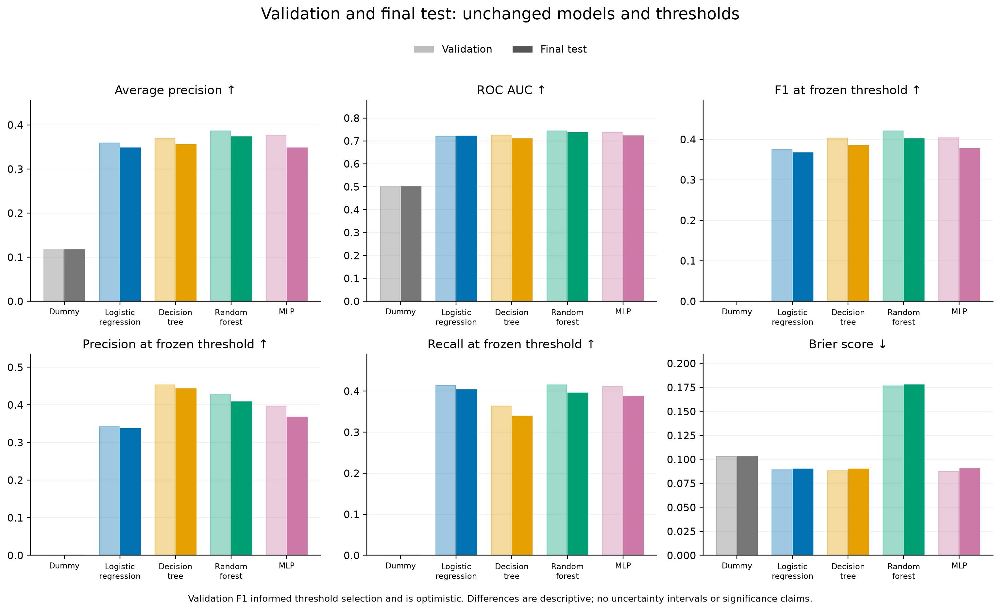

# CA6001 Member D — final evaluation report

> **Current status: final Test complete; saved-result support only.** The scores and figures below are retained results, not new Test inference in this delivery repair. The execution chronology, pre-test suite and earlier audit results are historical log/receipt evidence. Current commands use the new safe saved-result entry point; see [DELIVERY_README.md](../DELIVERY_README.md) and [DELIVERY_REPAIR.md](DELIVERY_REPAIR.md). The complete group report, slides and recording remain to be integrated.

The retained final evaluation receipt records successful completion of the authorized final test. The previously recommended Random Forest remains the selected family. On **9,043 held-out test records**, it achieved **AP 0.373566, ROC-AUC 0.736447 and F1 0.401537** at the unchanged threshold **0.6112421038019304**. Its validation F1 was 0.420901. All five frozen pipelines, including Dummy, were evaluated. No model was retrained, no threshold or hyperparameter changed, and no family was selected from the test results.

## Historical authorization, version and execution record

The user explicitly approved the previously proposed validation-based protocol and authorized one final test invocation in this conversation. All eight uncommitted preflight files were reviewed, with no unexpected files or blocking findings, then committed locally as **`ab46dfa884bd929f72ed76d50628cee1defab389`** on `member-d/validation-integration`. The worktree was clean immediately after that commit. Nothing was pushed or merged.

The protocol owner is **Member D (kangbobe)**; `kangbobe` is the configured local Git identity. The actual freeze time is **2026-10-19T08:18:48.589180+00:00** (16:18:48.589180 on 2026-10-19 in Asia/Shanghai). Approval status is **`approved`**, with **`frozen=true`**. Evaluation completed at **2026-10-19T08:18:59.733642+00:00**. The retained invocation record documents **one** `scripts/evaluate_test.py` invocation, exit status 0, and the four preserved files under `results/experiment/final_test/`. This is a statement about the recorded execution; these files cannot prove the absence of unrecorded historical invocations. The invocation record and complete log are retained in the QA evidence. No second invocation was used to test the one-shot refusal; that behavior was already covered by synthetic tests.

Frozen protocol SHA256: `708f9d126723ffa71961fe2d81924157c5c3c12d95c3d39c9dd43658bf73de4f`. The configuration copy and the evaluator's `frozen_protocol.json` have identical bytes. The original approval-pending proposal is preserved unchanged as the historical reviewed record; the separate `config/final_protocol.json` records approval.

## Historical pre-test verification

The historical suite log, before freezing and loading test labels, records **145 passing tests**, with **1 explicitly deselected legacy test**. A file-access guard recorded zero attempts to open the real dataset or five real model files during those tests. The excluded `tests/test_data.py::test_exact_split_coverage_and_partition_alignment` calls the full-table loader, which would parse test rows before the authorized evaluation. Its structural split checks were instead run through the original split-index/manifest loader without raw-row parsing; selective-loader and synthetic alignment tests remained active.

All **99 protected files** matched their pre-hardening SHA256 identities. The raw dataset, split indices, split manifest, five pipeline files, validation analysis configuration, validation evaluation receipt, selected threshold output and experiment metadata passed their required identity checks. All **68 installed package versions** matched `requirements.lock.txt`; `pip check` passed. Split sizes and coverage were verified as train 27,126, validation 9,042 and test 9,043, with each original row assigned exactly once. The committed inference/data/metric implementation and frozen artifacts were unchanged when the test began. Python was 3.12.14 on macOS arm64; the historical A/B/C training environment was Python 3.12.10 on Windows.

The frozen-protocol checks then required explicit approval, owner and timestamp, preserved experimental fields, and consistency with the proposal and validation receipt. The final evaluator independently repeated its gates before reserving the one-shot directory and loading test data. All gates passed. Hashing the raw file during preflight used opaque bytes, without parsing labels or computing performance.

## Evaluation methodology and frozen thresholds

The existing fitted pipelines were applied to the unchanged test split once. There were **1,058 positive (`yes=1`)** and **7,985 negative (`no=0`)** outcomes: prevalence **11.699657%**. Predictions use the probability column corresponding to class 1 and the inclusive rule `p_yes >= threshold`. All 9,043 saved row IDs exactly match the frozen test order, are unique, and have no train/validation overlap.

The decision rule was frozen verbatim:

> Unweighted validation F1 maximum over 0, adjacent distinct score midpoints, and 1; exact rational F1 ties choose highest candidate; predict yes iff p_yes >= threshold; Dummy fixed at 0.5.

| Model | Frozen threshold |
| --- | --- |
| Dummy | 0.5 |
| Logistic regression | 0.16796284539462858 |
| Decision tree | 0.2586600685192234 |
| Random forest | 0.6112421038019304 |
| MLP | 0.1896097366729046 |

The four real-model thresholds maximize unweighted validation F1 over decision-preserving candidate intervals, using the approved highest-threshold tie break. Dummy remains at 0.5. F1 is an academic precision/recall compromise; it was not selected to maximize an unobserved business profit function. No threshold optimization was performed on test predictions.

Average Precision (AP) is the primary ranking metric, using recall-increment-weighted precision rather than trapezoidal PR area. ROC-AUC, Brier score and log loss use continuous scores. Precision, recall, F1, accuracy, balanced accuracy and confusion counts use the frozen thresholds. Metrics are unweighted at the observed test prevalence. Displayed values below are rounded; the saved CSV and protocol retain full precision. AP and ROC-AUC do not change when an operating threshold changes; Brier score and log loss assess probability quality and must not be inferred from ranking metrics alone.

## Actual final-test results

| Model | AP | ROC-AUC | Precision | Recall | F1 |
| --- | --- | --- | --- | --- | --- |
| Dummy | 0.116997 | 0.500000 | 0.000000 | 0.000000 | 0.000000 |
| Logistic regression | 0.347906 | 0.720772 | 0.336751 | 0.403592 | 0.367154 |
| Decision tree | 0.355374 | 0.710182 | 0.443210 | 0.339319 | 0.384368 |
| Random forest | 0.373566 | 0.736447 | 0.408203 | 0.395085 | 0.401537 |
| MLP | 0.347914 | 0.722547 | 0.367055 | 0.387524 | 0.377011 |

| Model | Accuracy | Balanced accuracy | Brier score ↓ | Log loss ↓ |
| --- | --- | --- | --- | --- |
| Dummy | 0.883003 | 0.500000 | 0.103308 | 0.360898 |
| Logistic regression | 0.837222 | 0.649135 | 0.090048 | 0.316487 |
| Decision tree | 0.872830 | 0.641419 | 0.089911 | 0.356219 |
| Random forest | 0.862214 | 0.659596 | 0.177526 | 0.542927 |
| MLP | 0.850160 | 0.649491 | 0.090130 | 0.317658 |

Dummy predicts no positives at 0.5. Its precision denominator is zero; the project's shared convention reports precision as 0. Its AP equals test prevalence, ROC-AUC is 0.5 and recall/F1 are zero. Its 88.3003% accuracy is therefore not evidence of useful subscriber detection.

| Model | TN | FP | FN | TP | Predicted positive |
| --- | --- | --- | --- | --- | --- |
| Dummy | 7,985 | 0 | 1,058 | 0 | 0 |
| Logistic regression | 7,144 | 841 | 631 | 427 | 1,268 |
| Decision tree | 7,534 | 451 | 699 | 359 | 810 |
| Random forest | 7,379 | 606 | 640 | 418 | 1,024 |
| MLP | 7,278 | 707 | 648 | 410 | 1,117 |



*Figure 1. All five saved test score vectors; circles show the frozen operating thresholds. The Dummy PR point is omitted because no positives are predicted. The diagonal ROC reference and prevalence PR reference represent chance ranking. Curve cutoffs are descriptive coordinates, not new threshold candidates for selection.*



*Figure 2. Rows are observed classes and columns are predicted classes, ordered no/yes. All panels use the same shading scale and display raw counts at the approved thresholds.*

The preselected Random Forest had the highest observed AP, ROC-AUC and F1 among these fixed models. This is a descriptive holdout result, not a new selection step or evidence of statistically significant superiority. Decision Tree had the highest precision (0.443210), while Logistic Regression had the highest recall (0.403592). Logistic Regression and MLP had almost identical AP (difference approximately 0.0000084); this very small difference must not be presented as a meaningful separation. Both figure labels round to 0.348.

Probability-quality results differ from ranking results. Decision Tree had the lowest test Brier score (0.089911); Logistic Regression had the lowest log loss (0.316487). Random Forest's Brier score (0.177526) and log loss (0.542927) were worse than Dummy's 0.103308 and 0.360898. This supports caution about using its raw probabilities as reliable risks. These aggregate scores alone do not isolate calibration error from other components of probability quality. The Random Forest was fitted with balanced training weights, and no calibration procedure was added. The family recommendation was not changed in response to these results.

## Validation versus test

Both partitions use the same saved models and exact thresholds. Validation has 9,042 records and 1,058 positives (11.700951%); test has 9,043 records and 1,058 positives (11.699657%). Their nearly equal prevalence does not establish identical covariate distributions.

| Model | Validation AP | Test AP | Δ AP | Validation F1 | Test F1 | Δ F1 |
| --- | --- | --- | --- | --- | --- | --- |
| Dummy | 0.117010 | 0.116997 | -0.000013 | 0.000000 | 0.000000 | +0.000000 |
| Logistic regression | 0.358873 | 0.347906 | -0.010967 | 0.374679 | 0.367154 | -0.007525 |
| Decision tree | 0.369833 | 0.355374 | -0.014459 | 0.403564 | 0.384368 | -0.019196 |
| Random forest | 0.386507 | 0.373566 | -0.012942 | 0.420901 | 0.401537 | -0.019364 |
| MLP | 0.377185 | 0.347914 | -0.029271 | 0.403712 | 0.377011 | -0.026701 |

All differences are **test minus validation** in absolute metric units, not relative percentages. Additional differences are:

| Model | Δ ROC-AUC | Δ precision | Δ recall | Δ Brier | Δ log loss |
| --- | --- | --- | --- | --- | --- |
| Dummy | +0.000000 | +0.000000 | +0.000000 | -0.000010 | -0.000026 |
| Logistic regression | -0.000196 | -0.005437 | -0.010397 | +0.000674 | +0.001266 |
| Decision tree | -0.014594 | -0.009731 | -0.024575 | +0.001522 | +0.015442 |
| Random forest | -0.007363 | -0.018840 | -0.019849 | +0.001007 | +0.001968 |
| MLP | -0.015044 | -0.029481 | -0.023629 | +0.002571 | +0.008444 |



*Figure 3. Identical models and frozen thresholds across partitions. Validation F1 was optimized on the validation sample; these comparisons have no uncertainty intervals or significance tests. Brier score is lower-is-better.*

All four trained families had lower test AP, ROC-AUC and F1. For Random Forest, AP decreased by 0.012942 and F1 by 0.019364 (approximately 1.94 percentage points on the 0–1 F1 scale). Precision decreased from 0.427043 to 0.408203, and recall from 0.414934 to 0.395085. It predicted 1,024 positives on test versus 1,028 on validation, with 418 versus 439 true positives and 606 versus 589 false positives. MLP showed the largest AP/F1 decreases (0.029271/0.026701); Logistic Regression showed the smallest F1 decrease (0.007525).

Threshold selection on the validation set makes validation F1 optimistic for the resulting rule. Sampling variation can also contribute to the observed differences. AP was not the threshold objective, so its decline should not be attributed specifically to threshold tuning. A single random holdout comparison cannot separate these explanations, establish temporal drift, or demonstrate statistically significant deterioration. No retuning, calibration, retraining, additional family selection or new test-optimized operating point followed these observations.

## Error trade-offs and practical interpretation

At its frozen threshold, Random Forest selects **1,024 of 9,043 records (11.32%)**. Among these are 418 observed subscribers and 606 non-subscribers; it misses 640 of 1,058 subscribers (**60.49%**). Its false-positive rate is **7.59%**, with recall **39.51%**. These counts quantify the limitation behind F1 0.401537.

Relative to Decision Tree at its own frozen threshold, Random Forest identifies 59 more subscribers while including 155 more non-subscribers. Relative to Logistic Regression, it identifies 9 fewer subscribers but includes 235 fewer non-subscribers. These are aggregate count comparisons, not claims about individual-level agreement or causal outcomes.

False positives represent simulated outreach to recorded non-subscribers; false negatives represent excluding recorded subscribers. Contact costs, capacity, benefits and incremental effects are absent. Recorded subscription is not a measure of extra subscriptions caused by contact, so profit, ROI, causal lift and deployment utility cannot be calculated from these counts. The final test supplies predictive evidence for the frozen academic experiment, not an established production campaign policy.

## Explainability and limitations

The earlier error-group analysis and permutation importance remain validation evidence. They were not rerun or selected on the test set. Permutation importance used fitted pipelines, AP scoring, ten repetitions and seed 42. Previous campaign outcome was the largest measured reliance for all four real models; correlated history features and implausible independent shuffles limit that interpretation. The reported standard deviations describe variability across the ten permutation shuffles (`ddof=0`); they are not confidence intervals or uncertainty bounds for a population effect. Importance reflects model dependence and does not establish causality. Refer to the preserved Member D validation report for those results rather than relabeling them as test findings.

Random record splitting does not establish performance on future campaigns or unseen customers. Customer identifiers are unavailable, so customer-level isolation cannot be proved from disjoint row IDs. Historical sampling, uncertain as-of availability of some history fields, uncalibrated scores, threshold-selection optimism and exploratory validation subgroup comparisons limit generalization. No confidence interval, multiplicity-adjusted comparison, fairness certification or statistical-superiority claim is made here. The test is now observed and must not be reused to improve this experiment.

Original training-time source bytes were not captured. Existing posthoc verification establishes delivered identities and validation reproducibility; it does not prove which source bytes originally trained the pipelines. No reconstruction or backfilling was attempted. Original A/B/C artifacts and their historical metadata are unchanged; their pre-test `test_evaluated=false` entries describe that earlier handoff. The separate final evaluation receipt records the completed test. The strict historical validation-source check still requires a separate checkout at `29657cf` for reproducing earlier validation receipts.

## Historical independent post-evaluation verification

The retained post-run integrity record reports all 99 protected-file hashes unchanged after evaluation. An independent CSV/NumPy implementation recomputed all 16 metrics for all five models from saved predictions, without importing project metrics or sklearn metrics. AP was calculated at tied-score group boundaries; ROC-AUC used positive/negative rank comparisons with half credit for ties. Confusion metrics, Brier score and log loss were computed directly. The largest absolute discrepancy was **1.11 × 10⁻¹⁶**. Exact row order, class definitions, inclusive threshold decisions, selected thresholds and receipt/protocol identities also passed.

The reporting script separately reconciled the saved metrics and decisions before generating four CSVs, three PNG figures and three SVG equivalents. It reads saved predictions/metrics only; it does not read raw data, deserialize models, perform inference or fit anything. Synthetic smoke checks passed successful generation, refusal to overwrite an output directory, refusal of corrupted saved decisions, and refusal of inconsistent metrics. The earlier delivery records report visual inspection of all three actual final figure layouts; this repair did not regenerate those figures. The only reporting log notice was Matplotlib's first-time font-cache construction; evaluation produced no warning or failure.

## Report-ready results paragraph

Using a protocol frozen before test access, we evaluated the existing five train-fitted pipelines once on 9,043 held-out records, of which 1,058 were positive. Models, features, hyperparameters and validation-selected operating thresholds were unchanged. Random Forest, retained from the training-CV recommendation, achieved Average Precision 0.3736 and ROC-AUC 0.7364. At threshold 0.6112421038019304, its precision, recall and F1 were 0.4082, 0.3951 and 0.4015, respectively, with 418 true positives, 606 false positives, 640 false negatives and 7,379 true negatives. Its F1 was 0.0194 below the validation estimate. All four real models ranked above the Dummy baseline, but Random Forest's Brier score and log loss were worse than Dummy's, illustrating that ranking quality and probability quality are distinct. No model or threshold was changed after test inspection.

## Report-ready discussion paragraph

The held-out results retain the Random Forest recommendation made before final testing while showing weaker performance than the validation estimates and substantial missed-subscriber errors. Validation threshold optimization can make F1 optimistic; sampling variation can also contribute, and the single holdout does not identify the cause or establish significant differences. The precision–recall trade-off reflects a cost-unspecified academic objective rather than a validated profit optimum. Historical sampling, unavailable customer identifiers, uncalibrated probabilities and incomplete original training-source provenance constrain broader claims. Validation permutation importance describes model reliance rather than causal influence. These limitations should accompany the reported test scores, and future methodological changes require new evaluation evidence rather than reuse of this test set.

## Output inventory, identities and reproduction

The four one-shot outputs and their exact SHA256 identities are:

| One-shot output | SHA256 |
| --- | --- |
| evaluation_receipt.json | `82c46be05cdf9a976d5e738fb92133a1d7cdc5422e54acc32392eb59223b1398` |
| frozen_protocol.json | `708f9d126723ffa71961fe2d81924157c5c3c12d95c3d39c9dd43658bf73de4f` |
| test_metrics.csv | `5162c994dbe033d3047c6fd7eb2cf493e4dbfac47014b40202dd9c256c9e040d` |
| test_predictions.csv | `78c03be3b7dece1b2ce920b51298c70a79e3fa4ae3a73e8d02808fc3122fc1f6` |

The final analysis directory contains `validation_test_comparison.csv` (all 16 metrics for both partitions and deltas), `confusion_matrices.csv`, `roc_points.csv`, `pr_points.csv`, six figure files, `derivation_receipt.json`, QA evidence and its historical SHA256 manifest. ROC's initial cutoff is infinity; PR's terminal point has no cutoff. These conventions are recorded rather than treated as missing experiment data. The raw input, split, model, configuration, receipt and protocol identities are recorded in the frozen protocol and pre-test/post-run QA JSON files.

The historical [file/hash manifest](../results/member_d/final_test/SHA256SUMS.json) covers the original final-delivery versions of the frozen protocol, core final outputs, reporting source, this report, derived outputs and QA evidence. It is preserved unchanged; document hashes refer to the earlier bytes now retained in the [documentation snapshot manifest](history/delivery-v1/SNAPSHOT_MANIFEST.json). The new delivery uses an independent manifest, rather than rewriting historical audit evidence. [Test metrics](../results/experiment/final_test/test_metrics.csv), [test predictions](../results/experiment/final_test/test_predictions.csv), [comparison table](../results/member_d/final_test/validation_test_comparison.csv), [frozen protocol](../config/final_protocol.json), [derivation receipt](../results/member_d/final_test/derivation_receipt.json), and [independent numerical audit](../results/member_d/final_test/qa/independent_metrics_audit.json) are retained without overwriting the evaluator's outputs.

For saved-result arithmetic checks, use the safe entry with an explicit new output file. Optional reporting derivation also requires a new destination. These commands are current instructions, not a claim that this repair regenerated the analysis:

```bash
python scripts/report_final_results.py --root . --output work/final-report-reproduction
python scripts/audit_saved_results.py --root . --output work/audit-check-001.json
```

The final evaluator must not be rerun. Its fixed destination remains in place. Do not execute the preserved historical audit script directly: its old output policy overwrites the adjacent JSON. The new safe entry refuses existing files and frozen destinations. Integrate the results/discussion paragraphs and selected tables/figures into the existing ten-section CA6001 template and ten-page body limit, retaining the project's dataset attribution and references. This is Member D's final evaluation support, not a rewritten A/B/C report.

The preflight-hardening commit `ab46dfa` is historical local evidence. This limited delivery repair organizes the already existing D sources, tests, validation materials and final results and updates the safe documentation entry points. It does not reconstruct training provenance or replace any result. Current package/version/hash information and the status of the local delivery commit are recorded independently in the delivery index and repair record. No push or merge is part of this repair.
